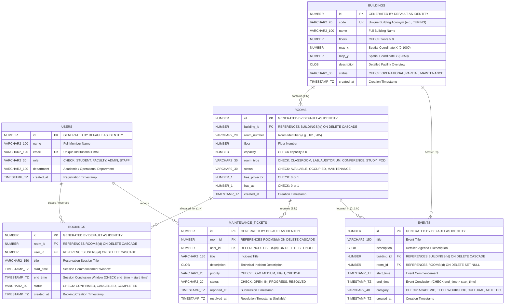

# CampusPulse — Relational Database Design & Normalization Specification
### Academic DBMS Project Architecture Report

---

## 1. Executive Summary & Problem Domain

**CampusPulse** is an enterprise smart campus operations platform and spatial digital twin designed to solve complex operational challenges across university infrastructure. Managing high-density university facilities requires seamless orchestration of:
1. **Multi-Building Campus Infrastructure**: Modeling physical structures, coordinates, operational statuses, and spatial footprints.
2. **Room Allocation & Spatial Types**: Tracking lecture halls, laboratories, auditoriums, conference suites, and study pods with capacity constraints and multimedia equipment availability.
3. **Conflict-Free Temporal Scheduling**: Enforcing mathematically rigorous, half-open interval `[start_time, end_time)` room booking prevention at both the DBMS engine layer and application transaction layer.
4. **Facility Maintenance Workflows**: Recording maintenance tickets, routing priorities (Low to Critical), and dynamically controlling room availability during repairs.
5. **Campus-Wide Event Management**: Scheduling academic symposia, hackathons, and cultural exhibitions mapped to campus zones and lecture halls.
6. **Real-Time Operational Analytics**: Deriving occupancy rates, utilization trends, and spatial load metrics using optimized SQL queries and database views.

---

## 2. Entity-Relationship (ER) Model

---

## 3. Relational Schema & Attribute Dictionary

### Relation 1: `USERS`
Stores registered university stakeholders authorized to reserve campus rooms or submit facility maintenance tickets.

| Attribute Name | Data Type (Oracle 21c) | Constraints | Description |
| :--- | :--- | :--- | :--- |
| `id` | `NUMBER GENERATED BY DEFAULT AS IDENTITY` | **PRIMARY KEY** | Unique surrogate identifier |
| `name` | `VARCHAR2(100)` | `NOT NULL` | Full legal name of member |
| `email` | `VARCHAR2(120)` | `NOT NULL`, **UNIQUE** (`uq_users_email`) | Institutional email address |
| `role` | `VARCHAR2(30)` | `NOT NULL`, `CHECK (role IN ('STUDENT','FACULTY','ADMIN','STAFF'))` | Authorization category |
| `department` | `VARCHAR2(100)` | `NULLABLE` | Academic or operations department |
| `created_at` | `TIMESTAMP WITH TIME ZONE` | `NOT NULL`, `DEFAULT CURRENT_TIMESTAMP` | Account creation timestamp |

### Relation 2: `BUILDINGS`
Represents physical campus structures containing rooms, zones, and events.

| Attribute Name | Data Type (Oracle 21c) | Constraints | Description |
| :--- | :--- | :--- | :--- |
| `id` | `NUMBER GENERATED BY DEFAULT AS IDENTITY` | **PRIMARY KEY** | Unique surrogate identifier |
| `code` | `VARCHAR2(20)` | `NOT NULL`, **UNIQUE** (`uq_buildings_code`) | Building acronym code (e.g. `ENG`, `TURING`) |
| `name` | `VARCHAR2(100)` | `NOT NULL` | Complete building title |
| `floors` | `NUMBER` | `NOT NULL`, `CHECK (floors > 0)` | Total above-ground floor count |
| `map_x` | `NUMBER` | `NOT NULL` | Canvas horizontal layout coordinate |
| `map_y` | `NUMBER` | `NOT NULL` | Canvas vertical layout coordinate |
| `description` | `CLOB` | `NULLABLE` | Architectural description |
| `status` | `VARCHAR2(30)` | `NOT NULL`, `CHECK (status IN ('OPERATIONAL','PARTIAL','MAINTENANCE'))` | Overall building operational status |
| `created_at` | `TIMESTAMP WITH TIME ZONE` | `NOT NULL`, `DEFAULT CURRENT_TIMESTAMP` | Ingestion timestamp |

### Relation 3: `ROOMS`
Models individual spatial subdivisions within campus buildings.

| Attribute Name | Data Type (Oracle 21c) | Constraints | Description |
| :--- | :--- | :--- | :--- |
| `id` | `NUMBER GENERATED BY DEFAULT AS IDENTITY` | **PRIMARY KEY** | Unique surrogate identifier |
| `building_id` | `NUMBER` | `NOT NULL`, **FOREIGN KEY** (`fk_rooms_building` $\to$ `BUILDINGS.id` **ON DELETE CASCADE**) | Parent building reference |
| `room_number` | `VARCHAR2(20)` | `NOT NULL` | Local room identifier (e.g. `101`, `204`) |
| `floor` | `NUMBER` | `NOT NULL`, `DEFAULT 1` | Floor index |
| `capacity` | `NUMBER` | `NOT NULL`, `CHECK (capacity > 0)` | Maximum seated capacity |
| `room_type` | `VARCHAR2(30)` | `NOT NULL`, `CHECK (room_type IN ('CLASSROOM','LAB','AUDITORIUM','CONFERENCE','STUDY_POD'))` | Functional classification |
| `status` | `VARCHAR2(30)` | `NOT NULL`, `CHECK (status IN ('AVAILABLE','OCCUPIED','MAINTENANCE'))` | Physical availability |
| `has_projector` | `NUMBER(1)` | `NOT NULL`, `CHECK (has_projector IN (0, 1))` | Boolean indicator for AV projector |
| `has_ac` | `NUMBER(1)` | `NOT NULL`, `CHECK (has_ac IN (0, 1))` | Boolean indicator for climate control |
| `created_at` | `TIMESTAMP WITH TIME ZONE` | `NOT NULL`, `DEFAULT CURRENT_TIMESTAMP` | Creation timestamp |
| *(Composite)* | — | **UNIQUE** (`uq_building_room_number`: `building_id`, `room_number`) | Room numbers are unique per building |

### Relation 4: `BOOKINGS`
Represents scheduled room reservations across discrete temporal intervals.

| Attribute Name | Data Type (Oracle 21c) | Constraints | Description |
| :--- | :--- | :--- | :--- |
| `id` | `NUMBER GENERATED BY DEFAULT AS IDENTITY` | **PRIMARY KEY** | Unique reservation receipt ID |
| `room_id` | `NUMBER` | `NOT NULL`, **FOREIGN KEY** (`fk_bookings_room` $\to$ `ROOMS.id` **ON DELETE CASCADE**) | Allocated room |
| `user_id` | `NUMBER` | `NOT NULL`, **FOREIGN KEY** (`fk_bookings_user` $\to$ `USERS.id` **ON DELETE CASCADE**) | Booking host / organizer |
| `title` | `VARCHAR2(150)` | `NOT NULL` | Purpose or meeting title |
| `start_time` | `TIMESTAMP WITH TIME ZONE` | `NOT NULL` | Half-open window start |
| `end_time` | `TIMESTAMP WITH TIME ZONE` | `NOT NULL`, `CHECK (end_time > start_time)` | Half-open window end |
| `status` | `VARCHAR2(30)` | `NOT NULL`, `CHECK (status IN ('CONFIRMED','CANCELLED','COMPLETED'))` | Lifecycle state |
| `created_at` | `TIMESTAMP WITH TIME ZONE` | `NOT NULL`, `DEFAULT CURRENT_TIMESTAMP` | Transaction timestamp |

### Relation 5: `MAINTENANCE_TICKETS`
Tracks facility work orders, HVAC/hardware defects, and automated room locks.

| Attribute Name | Data Type (Oracle 21c) | Constraints | Description |
| :--- | :--- | :--- | :--- |
| `id` | `NUMBER GENERATED BY DEFAULT AS IDENTITY` | **PRIMARY KEY** | Unique ticket serial number |
| `room_id` | `NUMBER` | `NOT NULL`, **FOREIGN KEY** (`fk_tickets_room` $\to$ `ROOMS.id` **ON DELETE CASCADE**) | Affected room |
| `user_id` | `NUMBER` | `NULLABLE`, **FOREIGN KEY** (`fk_tickets_user` $\to$ `USERS.id` **ON DELETE SET NULL**) | Submitting user (null for system bots) |
| `title` | `VARCHAR2(150)` | `NOT NULL` | Short defect summary |
| `description` | `CLOB` | `NOT NULL` | Comprehensive incident report |
| `priority` | `VARCHAR2(20)` | `NOT NULL`, `CHECK (priority IN ('LOW','MEDIUM','HIGH','CRITICAL'))` | Urgency tier |
| `status` | `VARCHAR2(20)` | `NOT NULL`, `CHECK (status IN ('OPEN','IN_PROGRESS','RESOLVED'))` | Remediation lifecycle |
| `reported_at` | `TIMESTAMP WITH TIME ZONE` | `NOT NULL`, `DEFAULT CURRENT_TIMESTAMP` | Ticket submission timestamp |
| `resolved_at` | `TIMESTAMP WITH TIME ZONE` | `NULLABLE` | Timestamp when marked RESOLVED |

### Relation 6: `EVENTS`
Catalogs campus-wide extracurricular, academic, and community gatherings.

| Attribute Name | Data Type (Oracle 21c) | Constraints | Description |
| :--- | :--- | :--- | :--- |
| `id` | `NUMBER GENERATED BY DEFAULT AS IDENTITY` | **PRIMARY KEY** | Unique event identifier |
| `title` | `VARCHAR2(150)` | `NOT NULL` | Public event headline |
| `description` | `CLOB` | `NULLABLE` | Full program itinerary |
| `building_id` | `NUMBER` | `NOT NULL`, **FOREIGN KEY** (`fk_events_building` $\to$ `BUILDINGS.id` **ON DELETE CASCADE**) | Host building |
| `room_id` | `NUMBER` | `NULLABLE`, **FOREIGN KEY** (`fk_events_room` $\to$ `ROOMS.id` **ON DELETE SET NULL**) | Assigned room (or whole complex) |
| `start_time` | `TIMESTAMP WITH TIME ZONE` | `NOT NULL` | Event start timestamp |
| `end_time` | `TIMESTAMP WITH TIME ZONE` | `NOT NULL`, `CHECK (end_time > start_time)` | Event conclusion timestamp |
| `category` | `VARCHAR2(40)` | `NOT NULL`, `CHECK (category IN ('ACADEMIC','TECH','WORKSHOP','CULTURAL','ATHLETIC'))` | Program category |
| `created_at` | `TIMESTAMP WITH TIME ZONE` | `NOT NULL`, `DEFAULT CURRENT_TIMESTAMP` | Scheduling timestamp |

---

## 4. Referential Integrity & Foreign Key Actions

| Foreign Key | Child Table | Referenced Parent Table | On Delete Action | Business Reason |
| :--- | :--- | :--- | :--- | :--- |
| `fk_rooms_building` | `ROOMS` | `BUILDINGS(id)` | **CASCADE** | A room cannot exist physically without its enclosing building structure. |
| `fk_bookings_room` | `BOOKINGS` | `ROOMS(id)` | **CASCADE** | If a room is permanently decommissioned, historical schedules for it are purged. |
| `fk_bookings_user` | `BOOKINGS` | `USERS(id)` | **CASCADE** | If a user account is deleted, their associated reservations are cleared. |
| `fk_tickets_room` | `MAINTENANCE_TICKETS` | `ROOMS(id)` | **CASCADE** | Work orders are structurally anchored to the physical room. |
| `fk_tickets_user` | `MAINTENANCE_TICKETS` | `USERS(id)` | **SET NULL** | Preserves facility maintenance history even if the reporting employee departs. |
| `fk_events_building` | `EVENTS` | `BUILDINGS(id)` | **CASCADE** | If a building is demolished, scheduled complex events cannot proceed. |
| `fk_events_room` | `EVENTS` | `ROOMS(id)` | **SET NULL** | If a specific room becomes unavailable, the event remains valid at the building level. |

---

## 5. Functional Dependencies (FD) Analysis

A functional dependency $X \to Y$ exists when the value of attribute set $X$ uniquely determines the value of attribute set $Y$.

### Relation 1: `USERS`
- $FD_1$: $\{id\} \to \{name, email, role, department, created\_at\}$
- $FD_2$: $\{email\} \to \{id, name, role, department, created\_at\}$
- **Candidate Keys**: $\{id\}$, $\{email\}$
- **Primary Key**: $\{id\}$

### Relation 2: `BUILDINGS`
- $FD_1$: $\{id\} \to \{code, name, floors, map\_x, map\_y, description, status, created\_at\}$
- $FD_2$: $\{code\} \to \{id, name, floors, map\_x, map\_y, description, status, created\_at\}$
- **Candidate Keys**: $\{id\}$, $\{code\}$
- **Primary Key**: $\{id\}$

### Relation 3: `ROOMS`
- $FD_1$: $\{id\} \to \{building\_id, room\_number, floor, capacity, room\_type, status, has\_projector, has\_ac, created\_at\}$
- $FD_2$: $\{building\_id, room\_number\} \to \{id, floor, capacity, room\_type, status, has\_projector, has\_ac, created\_at\}$
- **Candidate Keys**: $\{id\}$, $\{building\_id, room\_number\}$
- **Primary Key**: $\{id\}$

### Relation 4: `BOOKINGS`
- $FD_1$: $\{id\} \to \{room\_id, user\_id, title, start\_time, end\_time, status, created\_at\}$
- **Candidate Keys**: $\{id\}$
- **Primary Key**: $\{id\}$

### Relation 5: `MAINTENANCE_TICKETS`
- $FD_1$: $\{id\} \to \{room\_id, user\_id, title, description, priority, status, reported\_at, resolved\_at\}$
- **Candidate Keys**: $\{id\}$
- **Primary Key**: $\{id\}$

### Relation 6: `EVENTS`
- $FD_1$: $\{id\} \to \{title, description, building\_id, room\_id, start\_time, end\_time, category, created\_at\}$
- **Candidate Keys**: $\{id\}$
- **Primary Key**: $\{id\}$

---

## 6. Formal Normalization Proofs (1NF through BCNF)

### First Normal Form (1NF)
> **Definition**: A relation is in 1NF if and only if all underlying domains contain only atomic (indivisible) values, and there are no repeating groups or multivalued attributes.

- **Atomicity**: All attributes (`name`, `capacity`, `start_time`, `map_x`) store single scalar values.
- **No Multivalued Attributes**: Multimedia equipment is partitioned into discrete boolean columns (`has_projector`, `has_ac`) rather than comma-separated strings (`features = 'projector,ac'`).
- **No Repeating Groups**: Rather than storing multiple bookings inside room rows (`booking_1`, `booking_2`), reservations are stored as separate tuples in the dedicated `BOOKINGS` relation.
- **Conclusion**: **All 6 relations satisfy 1NF.**

### Second Normal Form (2NF)
> **Definition**: A relation is in 2NF if it is in 1NF and every non-prime attribute is fully functionally dependent on any candidate key (no partial functional dependencies).

- For relations `USERS`, `BUILDINGS`, `BOOKINGS`, `MAINTENANCE_TICKETS`, and `EVENTS`, the primary key is a single surrogate attribute (`id`). A single-attribute key has no proper subsets; therefore, partial dependency is mathematically impossible.
- For `ROOMS`, candidate keys are $\{id\}$ and $\{building\_id, room\_number\}$.
  - $\{id\}$ is a single attribute.
  - For composite key $\{building\_id, room\_number\}$, no attribute depends on only $building\_id$ (building details are stored in `BUILDINGS`) or only $room\_number$ (room 101 in Building A has different capacity and floor from room 101 in Building B). Every non-key attribute requires the full combination of building and room number.
- **Conclusion**: **All 6 relations satisfy 2NF.**

### Third Normal Form (3NF)
> **Definition**: A relation is in 3NF if it is in 2NF and for every non-trivial functional dependency $X \to Y$, either $X$ is a superkey or $Y$ is a prime attribute (no transitive dependencies $X \to Z \to Y$).

- In `USERS`: $\{id\} \to department$, but department does not determine role or name. No transitive dependencies exist.
- In `BUILDINGS`: $\{id\} \to code \to name$. Since $code$ is an alternate candidate key (UNIQUE), $code$ is a superkey. Hence, 3NF holds.
- In `ROOMS`: No non-key attribute determines any other non-key attribute (e.g., $capacity$ does not determine $room\_type$ or $status$).
- In `BOOKINGS`: Start and end times are independent of user or title.
- In `MAINTENANCE_TICKETS`: Priority does not determine status; title does not determine room.
- In `EVENTS`: Category does not determine building or timestamps.
- **Conclusion**: **All 6 relations satisfy 3NF.**

### Boyce-Codd Normal Form (BCNF)
> **Definition**: A relation is in BCNF if for every non-trivial functional dependency $X \to Y$, $X$ is a superkey.

- Across all 6 relations, the only determinants in active functional dependencies are $\{id\}$, $\{email\}$, $\{code\}$, and $\{building\_id, room\_number\}$.
- Every one of these determinants is a candidate key / superkey in its respective relation.
- **Conclusion**: **All 6 relations satisfy BCNF.**

---

## 7. Analysis of Relational Anomalies & Schema Protections

| Anomaly Type | Potential Risk if Unnormalized | CampusPulse Schema Solution |
| :--- | :--- | :--- |
| **Insertion Anomaly** | Inability to add a newly constructed building until rooms or bookings are created. | Buildings exist in a standalone `BUILDINGS` table, allowing registration before room construction. |
| **Deletion Anomaly** | Deleting a cancelled booking accidentally deleting the room or the user. | `BOOKINGS` is an associative entity. Deleting a booking does not remove the `ROOM` or `USER`. |
| **Update Anomaly** | Renaming a building requires modifying hundreds of room and booking records. | Building name exists solely in `BUILDINGS`. Child tables store only foreign key `building_id`. A single update propagates everywhere. |
| **Integrity Anomaly** | Booking end time precedes start time, or room has negative capacity. | Enforced at DBMS engine level via `CHECK (end_time > start_time)` and `CHECK (capacity > 0)`. |
| **Race Anomaly** | Concurrent users booking the same room for the same hour simultaneously. | Solved via **Row-Level Locking (`SELECT FOR UPDATE`)** and **PL/SQL Compound Trigger (`trg_no_overlapping_bookings`)**. |

---

## 8. Summary of Key Architectural Decisions

1. **Surrogate Keys vs Natural Keys**:
   - Every entity uses an auto-incrementing identity surrogate key (`NUMBER GENERATED BY DEFAULT AS IDENTITY PRIMARY KEY`).
   - Natural business keys (`email`, `code`, `building_id + room_number`) are enforced via `UNIQUE` constraints with supporting unique B-Tree indexes.
   - This provides compact, high-speed 4-byte/8-byte foreign key joins while maintaining real-world uniqueness.

2. **Temporal Model with Time Zones**:
   - All temporal columns use Oracle's `TIMESTAMP WITH TIME ZONE`.
   - This prevents ambiguous daylight saving transitions and ensures consistency across client browser time zones.

3. **Multi-Level Room Conflict Prevention**:
   - **Level 1 (Application)**: Half-open interval mathematical check `NOT (bk.end_time <= new.start OR bk.start_time >= new.end)`.
   - **Level 2 (Concurrency)**: Pessimistic row-level lock `SELECT ... FOR UPDATE` on the parent `ROOMS` row to serialize concurrent booking transactions for that room.
   - **Level 3 (DBMS Engine)**: Oracle PL/SQL Compound Trigger `trg_no_overlapping_bookings` running at the database kernel level to reject overlapping `CONFIRMED` bookings with `ORA-20001`, even for direct SQL inserts.

