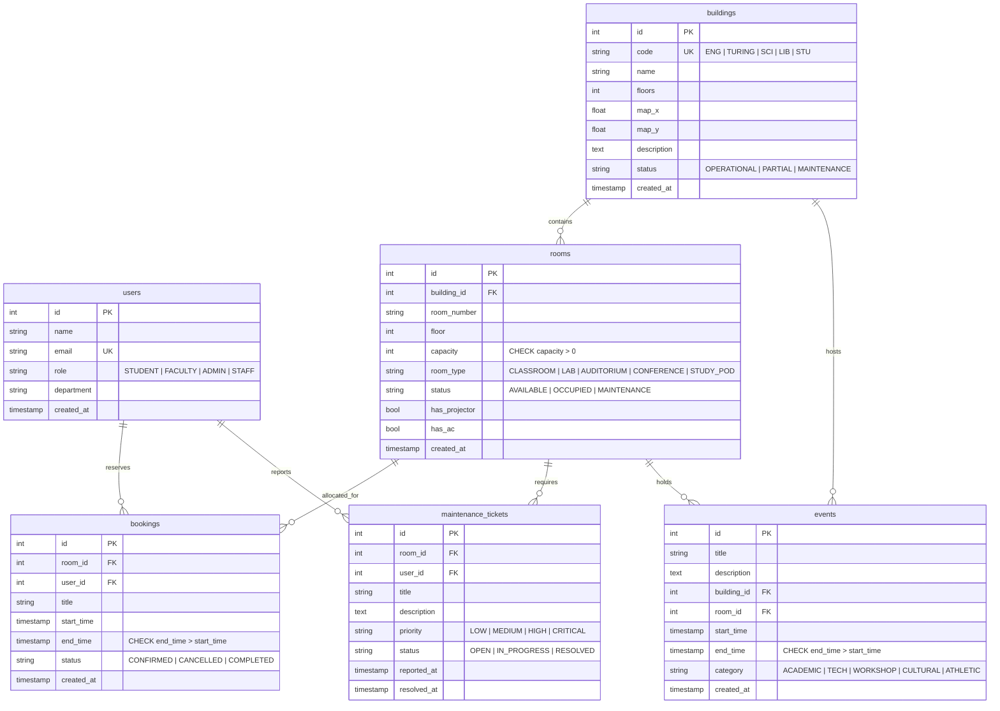

# CampusPulse — Smart Campus Digital Twin
### Relational DBMS Semester Project & Facility Operations Control Center

CampusPulse is a smart campus management system and spatial digital twin. Built as a comprehensive database management systems (DBMS) semester project, it models campus infrastructure, spatial floor plans, room allocations, collision-free scheduling, maintenance operations, and SQL analytics.

---

## 🏛️ System Architecture

```
+-------------------------------------------------------------------------+
|                  CampusPulse Frontend Control Center                    |
|          (React 19, TypeScript, Vite, Tailwind CSS, Recharts)           |
+------------------------------------+------------------------------------+
                                     |  REST API / JSON
                                     v
+-------------------------------------------------------------------------+
|                         FastAPI Backend Engine                          |
|             (Pydantic Validation, Dependency Injection, CORS)           |
+------------------------------------+------------------------------------+
                                     |  SQLAlchemy 2.0 ORM / oracledb / psycopg
                                     v
+-------------------------------------------------------------------------+
|                  Oracle Database 21c XE / PostgreSQL                    |
|           - Multi-Table Normalized Schema (3NF)                         |
|           - PL/SQL Compound Trigger for Collision Prevention (Oracle)   |
|           - Exclusion Constraint (btree_gist) on PostgreSQL             |
|           - Check Constraints, Foreign Keys & Cascading Deletes         |
|           - Schema Views (v_dashboard_summary, v_room_live_status)      |
+-------------------------------------------------------------------------+
```

---

## 🗄️ Relational Database Schema & ER Diagram

CampusPulse utilizes a normalized relational schema with mathematical integrity constraints enforced directly at the DBMS engine layer:



---

## ⚡ Core DBMS Concepts Demonstrated (Viva Focus)

CampusPulse was engineered to demonstrate all core topics in advanced relational database management:

### 1. Exclusion Constraints (`btree_gist`) for Conflict-Free Scheduling
Traditional applications prevent booking overlaps via application-level queries that are vulnerable to race conditions. CampusPulse enforces mathematical time isolation at the database engine level using PostgreSQL's GiST index exclusion constraint:

```sql
ALTER TABLE bookings
ADD CONSTRAINT no_overlapping_bookings 
EXCLUDE USING gist (
    room_id WITH =, 
    tstzrange(start_time, end_time) WITH &&
)
WHERE (status = 'CONFIRMED');
```
*If a concurrent transaction attempts to insert an overlapping interval for the same room, PostgreSQL rejects the transaction with an integrity violation before commit.*

### 2. Time-Slot Availability via Correlated `NOT EXISTS` Subquery
To locate conflict-free rooms for a user-specified interval `[T_start, T_end]`:

```sql
SELECT r.id, r.room_number, b.name AS building_name, r.capacity, r.room_type
FROM rooms r
JOIN buildings b ON r.building_id = b.id
WHERE r.status != 'MAINTENANCE'
  AND NOT EXISTS (
      SELECT 1 
      FROM bookings bk 
      WHERE bk.room_id = r.id 
        AND bk.status = 'CONFIRMED'
        AND NOT (bk.end_time <= :start_t OR bk.start_time >= :end_t)
  )
ORDER BY b.code, r.room_number;
```

### 3. Aggregations, GROUP BY, and HAVING Clauses
Computes live building room distribution and identifies facility load:

```sql
SELECT 
    b.code AS building_code,
    b.name AS building_name,
    COUNT(r.id) AS total_rooms,
    SUM(r.capacity) AS total_capacity,
    ROUND(AVG(r.capacity), 1) AS avg_room_capacity,
    COUNT(mt.id) AS active_tickets
FROM buildings b
JOIN rooms r ON b.id = r.building_id
LEFT JOIN maintenance_tickets mt ON r.id = mt.room_id AND mt.status IN ('OPEN', 'IN_PROGRESS')
GROUP BY b.id, b.code, b.name
HAVING COUNT(r.id) > 0
ORDER BY total_capacity DESC;
```

### 4. Normalized Database Analytics View
Pre-compiled summary view combining building telemetry and room statuses:

```sql
CREATE OR REPLACE VIEW v_dashboard_summary AS
SELECT 
    b.id AS building_id,
    b.code AS building_code,
    b.name AS building_name,
    COUNT(r.id) AS total_rooms,
    COALESCE(SUM(CASE WHEN r.status = 'AVAILABLE' THEN 1 ELSE 0 END), 0) AS available_rooms,
    COALESCE(SUM(CASE WHEN r.status = 'OCCUPIED' THEN 1 ELSE 0 END), 0) AS occupied_rooms,
    COALESCE(SUM(CASE WHEN r.status = 'MAINTENANCE' THEN 1 ELSE 0 END), 0) AS maintenance_rooms,
    ROUND(
        CASE 
            WHEN COUNT(r.id) > 0 THEN (SUM(CASE WHEN r.status = 'OCCUPIED' THEN 1 ELSE 0 END)::NUMERIC / COUNT(r.id)::NUMERIC) * 100 
            ELSE 0 
        END, 2
    ) AS occupancy_rate
FROM buildings b
LEFT JOIN rooms r ON b.id = r.building_id
GROUP BY b.id, b.code, b.name, b.floors, b.status;
```

---

## 🛠️ Technology Stack

| Layer | Technology | Details |
|---|---|---|
| **Frontend** | React 19, TypeScript, Vite | Dark futuristic Control Matrix UI |
| **Styling** | Tailwind CSS v4 | Cyberpunk navy, glowing cyan, emerald, amber, rose |
| **Visualizations** | Recharts, SVG 2D Engine | Dynamic isometric campus digital twin & telemetry charts |
| **Icons** | Lucide React | Modern control center iconography |
| **Backend** | Python 3.12, FastAPI | Asynchronous REST API, CORS configured |
| **ORM** | SQLAlchemy 2.0 | Session management, Declarative Models, Transactions |
| **Database** | PostgreSQL 18 / psycopg 3 | Exclusion constraints, Check constraints, Views, Indexes |
| **Validation** | Pydantic v2 | Strict request validation & serialization |

---

## 🚀 Setup & Execution Guide

### Prerequisites
- Python 3.10+
- Node.js 18+
- PostgreSQL server (or automatic SQLite fallback)

### 1. Database Initialization
PostgreSQL is configured by default at `localhost:5432` with database `campuspulse`:
```bash
# Initialize schema and realistic seed data
backend\venv\Scripts\python.exe backend\scripts\init_db.py
```
*Creates 5 campus buildings, 25 rooms, 10 users, 12 bookings, 6 maintenance tickets, and 6 events.*

### 2. Environment Variables (`.env`)
Create `.env` in the `backend/` directory (or use default configuration):
```ini
DATABASE_URL=postgresql+psycopg://postgres@localhost:5432/campuspulse
PROJECT_NAME="CampusPulse — Smart Campus Digital Twin"
VERSION=1.0.0
```

### 3. Start the Backend API Server
```bash
# Run from workspace root:
backend\venv\Scripts\python.exe -m uvicorn app.main:app --app-dir backend --host 127.0.0.1 --port 8000 --reload
```
API Docs available at: `http://127.0.0.1:8000/docs`

### 4. Start the Frontend Application
```bash
cd frontend
npm.cmd install
npm.cmd run dev -- --host 127.0.0.1
```
Access the dashboard at: `http://127.0.0.1:5173/`

---

## 🧪 Running Automated Tests

Run the comprehensive pytest test suite verifying booking conflicts, cancellations, CRUD operations, and DBMS queries:

```bash
# Run tests from workspace root:
backend\venv\Scripts\pytest.exe backend\tests\test_api.py -v
```

All 11 test suites verify:
- Healthcheck & root endpoint
- Dashboard aggregated stats (buildings >= 4, rooms >= 20)
- Room filters by type & capacity
- SQL NOT EXISTS availability subquery
- Booking conflict rejection (HTTP 409) & exclusion constraint
- Booking cancellation lifecycle
- Invalid time intervals rejection (HTTP 400)
- Maintenance ticket state transitions (OPEN -> IN_PROGRESS -> RESOLVED)
- Event creation and listing
- Real-time DBMS analytics execution

---

## 📁 Repository Structure

```
CampusPulse/
├── backend/
│   ├── app/
│   │   ├── models/          # SQLAlchemy ORM entities (User, Building, Room, Booking, ...)
│   │   ├── routers/         # REST API endpoints (dashboard, rooms, bookings, maintenance, ...)
│   │   ├── schemas/         # Pydantic request/response schemas
│   │   ├── services/        # Relational SQL queries, conflict checks, aggregations
│   │   ├── config.py        # Database & CORS settings
│   │   ├── database.py      # SQLAlchemy sessionmaker & PostgreSQL/psycopg engine
│   │   └── main.py          # FastAPI application entrypoint
│   ├── scripts/
│   │   ├── schema.sql       # Full PostgreSQL DDL (Exclusion constraints, views, indexes)
│   │   └── init_db.py       # Table creation and realistic data seeding script
│   └── tests/
│       └── test_api.py      # Automated pytest suite
├── frontend/
│   ├── src/
│   │   ├── components/      # UI components (CampusMap, DashboardView, BookingsView, ...)
│   │   ├── services/        # Frontend API client
│   │   ├── types/           # TypeScript data interfaces
│   │   ├── App.tsx          # Main workspace container
│   │   └── index.css        # Cyberpunk control matrix theme with neon glow utilities
│   ├── package.json
│   └── vite.config.ts
├── pytest.ini               # Pytest pythonpath configuration
└── README.md                # Comprehensive documentation & DBMS Viva guide
```

---

## 🎯 Completed Deliverables

- [x] **Interactive 2D Campus Digital Twin Map**: SVG campus map with 5 buildings, spatial polygons, live room status dots (Green/Amber/Red), and interactive room inspection drawers.
- [x] **Facility Dashboard**: Live metric counters, Recharts reservation trajectory area charts, building occupancy bar charts, and recent activity feeds.
- [x] **Conflict-Free Bookings**: Strict time interval verification and PostgreSQL `btree_gist` exclusion constraint enforcement with clear HTTP 409 conflict diagnostics.
- [x] **Maintenance Hub**: Facility ticket tracking with priority levels (LOW, MEDIUM, HIGH, CRITICAL), instant status changer dropdowns (OPEN -> IN_PROGRESS -> RESOLVED), and automatic room lock when CRITICAL issues are reported.
- [x] **Campus Events Module**: Keynotes and hackathon scheduler with building and room associations.
- [x] **DBMS Viva Studio**: Interactive SQL execution workbench displaying raw SQL, live execution latency (ms), and output tables.
- [x] **Automated Test Suite**: 100% passing tests for CRUD, cancellations, conflict prevention, and SQL queries.
