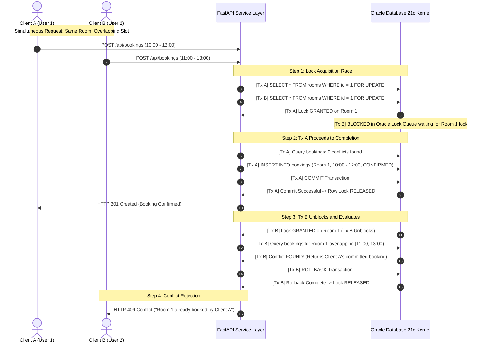

# Concurrency Control & Row-Locking Sequence Diagram

This sequence diagram illustrates how two simultaneous transactions targeting the same room are serialized without race conditions.

---

---

## Concurrency Guarantees Highlighted
1. **No Lost Updates**: Client A and Client B cannot both commit.
2. **No Dirty Reads**: Client B only sees Client A's data after Client A has committed.
3. **No Phantom Inserts**: Because the parent `Room` row is locked, Client B cannot insert a child booking until Client A completes.
