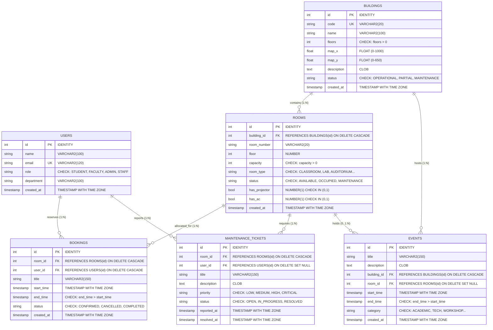

# Relational Entity-Relationship (ER) Diagram

This document provides the formal Entity-Relationship model for the CampusPulse database schema across its 6 normalized relations.

---

---

## Key Cardinalities & Constraints
1. **Composite Uniqueness**: In `ROOMS`, `UNIQUE(building_id, room_number)` ensures no duplicate room numbers within the same building.
2. **Cascading Purge**: When a `BUILDING` or `ROOM` is permanently removed, dependent `BOOKINGS` and `ROOMS` are purged automatically via `ON DELETE CASCADE`.
3. **Audit Preservation**: When a `USER` account is deleted, foreign keys in `MAINTENANCE_TICKETS` are set to `NULL` via `ON DELETE SET NULL`, preserving the facility repair history.
