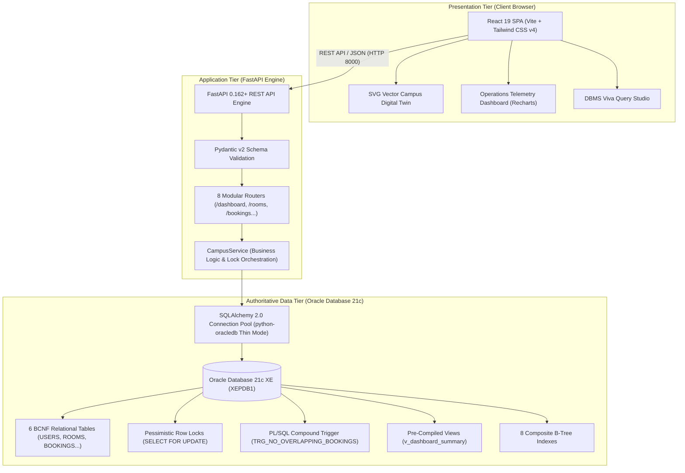

# System Architecture Diagram

This document contains the visual architectural diagram of the CampusPulse 3-Tier Enterprise System.

---

---

## Architectural Description
1. **Presentation Tier**: Built in React 19 and TypeScript, running in the user's browser. It features a spatial digital twin rendered with pure SVG, reactive data visualization via Recharts, and an embedded SQL execution workbench.
2. **Application Tier**: Built on FastAPI, running on Python 3.12. Incoming HTTP requests are validated using strict Pydantic schemas before reaching the service layer. `CampusService` orchestrates ACID transaction boundaries, interval calculations, and row-level locking.
3. **Data Tier**: Powered by Oracle Database 21c XE running pluggable database `XEPDB1`. All transactions are handled through `python-oracledb` in Thin Mode with automated connection pooling and pre-ping verification. Integrity is guaranteed through schema constraints and a kernel-level compound trigger.
